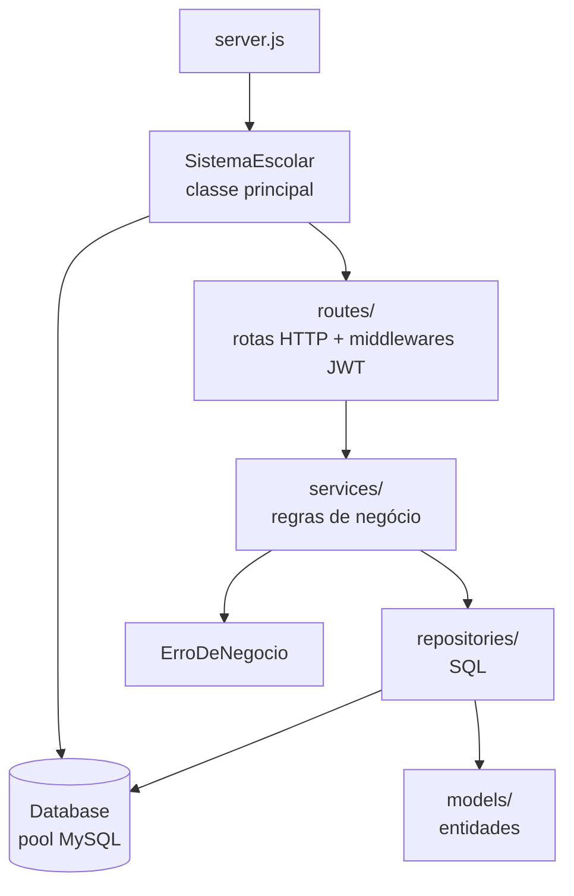
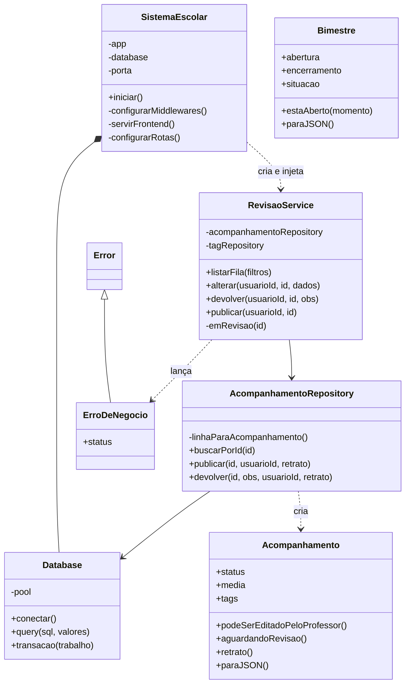

# Entrega 2 — Programação Orientada a Objetos
## KFKA – Plataforma de Acompanhamento Escolar

**Integrantes:** Daniel Bandini Grande, João Pedro Teixeira dos Santos, Raphael Carmo Mendes, Guilherme Koide Rangel

**Objetivo da entrega:** subir o backend do projeto, garantindo que o sistema esteja disponível e acessível tanto em **servidor local (localhost)** quanto **na nuvem**, com o serviço de backend configurado e a conexão com o banco de dados funcionando.

| Ambiente | Endereço | Situação |
| --- | --- | --- |
| ☁️ Nuvem (Railway) | https://projeto12-production.up.railway.app | Front + back + MySQL em produção |
| 💻 Servidor local | http://localhost:3001 (API) · http://localhost:5173 (telas) | Instruções abaixo |

Código-fonte do backend: pasta [`/backend`](../../../backend) na raiz deste repositório.

---

## 1. Classe principal: `SistemaEscolar`

Arquivo: [`backend/core/SistemaEscolar.js`](../../../backend/core/SistemaEscolar.js)

É a classe que orquestra o sistema inteiro. O arquivo `server.js` só cria uma instância e chama `iniciar()`:

```js
const SistemaEscolar = require('./core/SistemaEscolar');

// Na nuvem, a plataforma informa a porta pela variável PORT; no computador, usamos a 3001
const sistema = new SistemaEscolar(Number(process.env.PORT) || 3001);
sistema.iniciar();
```

O método `iniciar()` executa as etapas sempre na mesma ordem:

1. **Conecta ao banco** (`Database.conectar()`). Se falhar, encerra o processo antes de expor qualquer rota.
2. **Configura os middlewares** (CORS e leitura de JSON).
3. **Serve o frontend compilado**, mas só em produção. Na nuvem, o próprio backend entrega as telas do React (pasta `frontend/dist`), e o sistema inteiro fica em um único endereço.
4. **Monta as dependências e registra as rotas.** Cria os *repositories* (acesso a dados), injeta-os nos *services* (regras de negócio) e entrega os services às rotas.
5. **Sobe o servidor HTTP** na porta recebida.

Em relação à Entrega 1, a classe passou a integrar **todos os módulos** do sistema: cadastros, bimestres, acompanhamento do professor, revisão/publicação, área do responsável (com PDF), relatórios/exportação Excel e recuperação de senha.

---

## 2. Arquitetura em camadas



| Camada | Pasta | Classes |
| --- | --- | --- |
| Núcleo | `core/` | `SistemaEscolar`, `Database` |
| Entidades | `models/` | `Usuario`, `Aluno`, `Professor`, `Responsavel`, `Turma`, `Disciplina`, `AreaDisciplina`, `Tag`, `Bimestre`, `Acompanhamento` |
| Acesso a dados | `repositories/` | `UsuarioRepository`, `AlunoRepository`, `ProfessorRepository`, `ResponsavelRepository`, `TurmaRepository`, `DisciplinaRepository`, `AreaDisciplinaRepository`, `TagRepository`, `BimestreRepository`, `AcompanhamentoRepository`, `RelatorioRepository`, `RecuperacaoSenhaRepository` |
| Regras de negócio | `services/` | `AcompanhamentoService`, `RevisaoService`, `AreaResponsavelService`, `SenhaService`, `GeradorPdf`, `ExportadorPlanilha`, `NotificadorEmail` |
| Erros | `errors/` | `ErroDeNegocio` (herda de `Error`) |
| Rotas / segurança | `routes/`, `middlewares/` | rotas por assunto; `verificarToken` e `somentePerfis` (JWT + perfil) |

### Diagrama das classes principais



---

## 3. Conceitos de POO aplicados

**Encapsulamento.** Atributos e métodos privados com `#`: só a própria classe tem acesso.
- `Database` guarda o pool de conexões em `#pool`; o resto do sistema só enxerga `query()` e `transacao()`.
- `SistemaEscolar` tem `#app`, `#database`, `#porta` e métodos privados de configuração.
- Os repositories têm conversores privados (`#linhaParaAluno`, `#linhaParaAcompanhamento`...), e os services guardam suas dependências privadas (`#acompanhamentoRepository`).

**Abstração.** As rotas não sabem SQL, e os services não sabem HTTP. Por exemplo, `RevisaoService.publicar()` só pede ao repository que publique; como isso vira `UPDATE` + histórico dentro de uma transação é problema do `AcompanhamentoRepository`.

**Herança.** `ErroDeNegocio extends Error` acrescenta o código HTTP (`status`) ao erro padrão do JavaScript. Os services lançam `new ErroDeNegocio(409, '...')`, e as rotas convertem isso em uma resposta padronizada.

```js
class ErroDeNegocio extends Error {
  constructor(status, mensagem) {
    super(mensagem);
    this.name = 'ErroDeNegocio';
    this.status = status;
  }
}
```

**Polimorfismo.** Todas as entidades implementam `paraJSON()`, cada uma do seu jeito (por exemplo, `Usuario.paraJSON()` **nunca** inclui o hash da senha). As rotas chamam o mesmo método sem saber qual entidade estão serializando. Da mesma forma, o `NotificadorEmail` pode ser trocado por outra implementação com o mesmo método `enviarRecuperacaoSenha()` (hoje simulado no console; em produção, SMTP) sem alterar o `SenhaService`.

**Comportamento no objeto (modelo rico).** As regras ficam na própria entidade:
- `Bimestre.estaAberto()` diz se a digitação está liberada (RF04/RF05).
- `Acompanhamento.podeSerEditadoPeloProfessor()` / `aguardandoRevisao()` controlam o fluxo Rascunho → Enviado → Publicado/Devolvido (RF06).
- `Acompanhamento.retrato()` gera o "estado anterior/posterior" gravado no histórico de auditoria (RF07).

**Composição e injeção de dependência.** `SistemaEscolar` cria um único `Database` e o injeta em todos os repositories; os repositories são injetados nos services, e os services nas rotas. Nenhuma classe cria suas próprias dependências, o que deixa o código desacoplado e fácil de testar.

**Responsabilidade única.** Cada classe tem uma preocupação só: `GeradorPdf` só monta PDF, `ExportadorPlanilha` só gera .xlsx/.csv, `Database` só conversa com o MySQL, `SistemaEscolar` só orquestra.

---

## 4. Como executar em servidor local (localhost)

**Pré-requisitos:** Node.js 22+ e **MySQL 8** em execução.

```sh
# 1) Backend
cd backend
npm install
cp .env.example .env        # no Windows: copy .env.example .env
#   → edite o .env e coloque a senha do seu MySQL
npm run dados               # cria o banco "sistema_escolar" com dados fictícios
npm start                   # API em http://localhost:3001

# 2) Frontend (em outro terminal)
cd frontend
npm install
npm run dev                 # telas em http://localhost:5173
```

Variáveis do `.env` (o arquivo **não** é versionado; credenciais ficam fora do código):

| Variável | Exemplo | Para quê |
| --- | --- | --- |
| `DB_HOST` / `DB_PORT` | `127.0.0.1` / `3306` | endereço do MySQL |
| `DB_USER` / `DB_PASSWORD` | `root` / *sua senha* | credenciais do MySQL |
| `DB_NAME` | `sistema_escolar` | nome do banco |
| `JWT_SECRET` | texto longo aleatório | assinatura dos tokens de login |
| `FRONTEND_URL` | `http://localhost:5173` | link de recuperação de senha |

Ao subir, o terminal mostra:

```
Conectado ao MySQL!
Servidor rodando na porta 3001
```

e `http://localhost:3001/` responde **`API rodando`**.

> Observação: o sistema usa recursos do **MySQL 8** (ex.: `INSERT ... AS novo ON DUPLICATE KEY UPDATE`). Não use MariaDB.

---

## 5. Como está publicado na nuvem (Railway)

- **Serviço MySQL** gerenciado pelo Railway; as credenciais são passadas ao backend por **variáveis de ambiente** (`DB_HOST`, `DB_USER`, `DB_PASSWORD`, `DB_NAME`, `DB_PORT`, `JWT_SECRET`, `FRONTEND_URL`), nunca pelo código.
- **Serviço da aplicação** usando o `package.json` da raiz:
  - `build`: compila o React (`frontend/dist`) e instala as dependências do backend;
  - `start`: `npm --prefix backend start` → executa `server.js` → `SistemaEscolar`.
- A porta é informada pela plataforma em `PORT`, e o `server.js` a repassa para `SistemaEscolar`.
- Como `frontend/dist` existe no build, `SistemaEscolar.#servirFrontend()` entrega as telas e a API no **mesmo endereço**.
- O `Database` ajusta cada conexão para o fuso de Brasília (`SET time_zone = '-03:00'`), porque servidores na nuvem rodam em UTC.

---

## 6. Evidências: cenário de ponta a ponta executado em localhost

Teste feito com o backend rodando em `http://localhost:3001` sobre MySQL 8, com o banco criado por `npm run dados`:

```
== 0. API no ar: API rodando
== Segurança: sem token -> 401 | professor em rota de admin -> 403
== 1. Professor salva rascunho (Lucas Oliveira, Língua Portuguesa, 4º bim)
   {"id":548, ..., "media":8.5, "status":"rascunho", "tags":[{"id":2,"nome":"Ótimo desempenho"}]}
== Validação: média 11 -> {"erro":"A média deve ser um número de 0 a 10, com no máximo uma casa decimal."}
== 2. Professor envia para revisão (id 548)  -> status: enviado
== 3. Administrador publica                  -> status: publicado
   histórico: criado (Beatriz Santos) → enviado (Beatriz Santos) → publicado (Secretaria KFKA)
== 4. Responsável consulta e baixa PDF
   PDF: HTTP 200 — "Língua Portuguesa — média 8,5 · Professor(a): Beatriz Santos · Tags: Ótimo desempenho"
== 5. Administrador exporta Excel
   XLSX: HTTP 200, 27 KB
```

Isso cobre o critério de aceitação do projeto: *Administrador abre o bimestre → Professor registra e envia → Administrador revisa e publica → Responsável consulta e gera o PDF → Administrador exporta para Excel*.

### Acessos de demonstração

| Perfil | E-mail | Senha |
| --- | --- | --- |
| Administrador | admin@escola.com | Admin2026 |
| Professor(a) | beatriz@escola.com | Prof2026 |
| Responsável | maria@email.com | Resp2026 |
